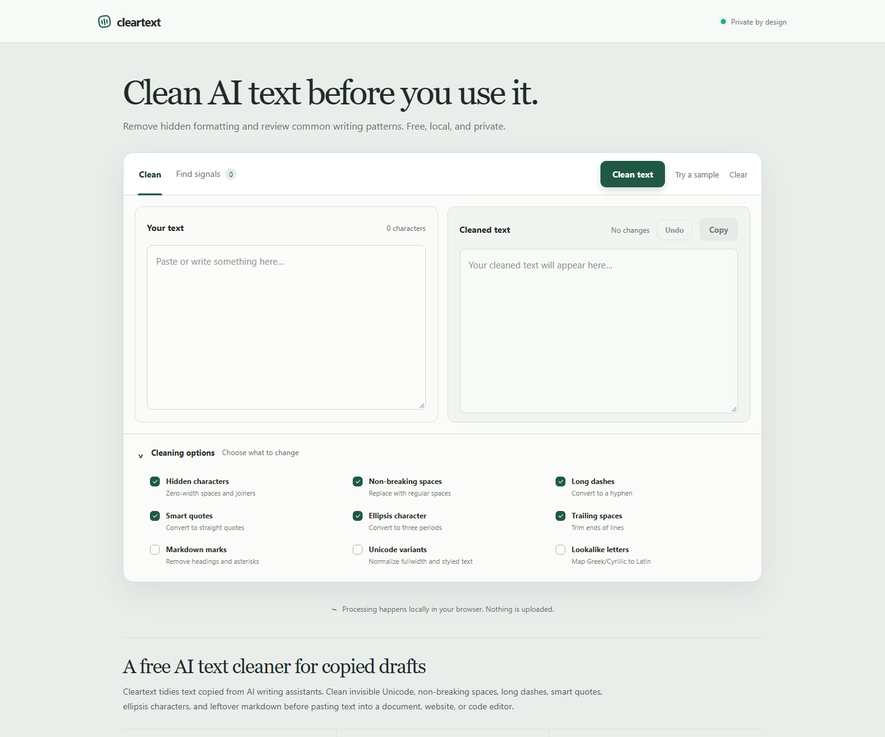

# Cleartext

**Clean AI text before you use it.** Cleartext is a free, private, browser based tool for tidying copied drafts and reviewing common writing patterns.

[Open Cleartext](https://cleartext.nobojit.com/)



## What it does

- Remove hidden Unicode characters, non-breaking spaces, long dashes, smart quotes, ellipsis characters, and trailing spaces.
- Optionally remove selected Markdown marks, normalize styled Unicode, or map common Greek and Cyrillic lookalikes to Latin letters.
- Review a before and after comparison, undo the cleanup, and copy the result.
- Find selected phrases, formatting artifacts, and repeated sentence openings as editing prompts.

Signal matches are simple pattern matches. They can occur in human writing and are not an authorship verdict.

## Privacy

Text processing runs in your browser. This static project has no server code or upload flow, and the text you enter is not sent anywhere by the app.

## Run it

Open `index.html` in your browser. On Windows, double-clicking the file opens it in your default browser. No server, build step, or dependency installation is required.

### Optional: use a local web server

If your browser restricts the **Copy** button when the page is opened as a file, you can serve the folder locally instead:

```sh
python -m http.server 8000
```

Then open <http://localhost:8000>.

## Publish with GitHub Pages

The site is plain HTML, CSS, and JavaScript. In the repository settings, choose **Pages**, set the source to deploy from a branch, and select the root folder of `main`.

## Project files

- `index.html` — page structure and metadata
- `styles.css` — responsive layout and visual styles
- `app.js` — text cleanup and signal matching
- `docs/cleartext-preview.png` — project screenshot used above
